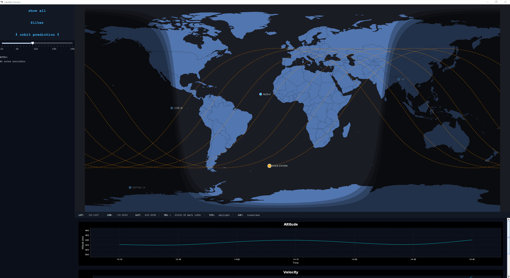
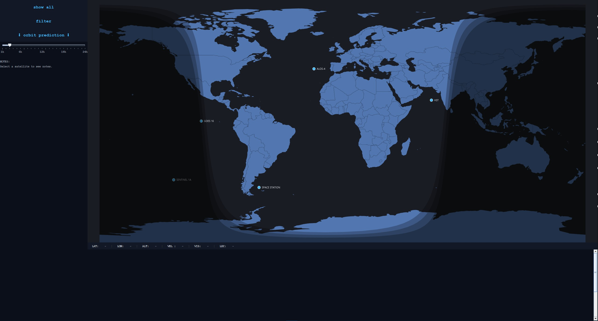
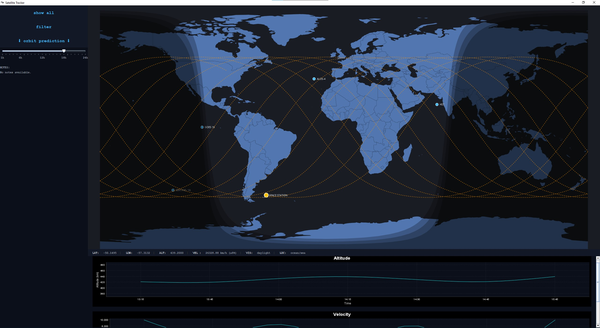
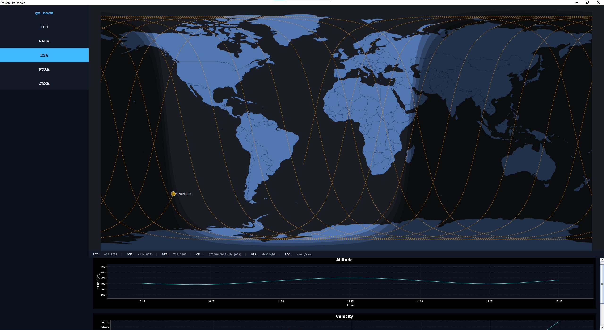

## Satellite Tracker
A real-time satellite tracker built in Java. It fetches live satellite position data from the [n2yo.com](https://www.n2yo.com/api/) API, stores historical satellite passes in a SQL database, and visualises satellite movement on an interactive world map using JavaFX.



# Features
- **Live satellite tracking** — Fetches current satellite position data from the N2Yo API.
- **Historical data storage** — Stores satellite pass data in a SQL database.
- **Real-time visualisation** — Displays satellite positions and movement on an interactive world map.
- **Custom satellites** — Add or remove satellites from the tracker by editing the satellite list.
- **Satellite information** — Displays orbital and identification information for tracked satellites.
- **Pass tracking** — Receords satellite passes for later viewing and analysis

# Screenshots

**Main Tracker**


**Tracking Satellite**


**Hiding All Satellites Excluding Tracked Satellite**


# Technologies
- Java
- JavFX
- SQL
- N2YO API
- HTML / JavaScript
- AMCharts — The world map component is based on the AMCharts and has been modified and integrated into the application.

# Why I Built This
I'm a Computer Science student interested in scientific software engineering and eventually working in the fields of space and particle physics.

I built this project to gain practical experience working with:
- Java
- JavaFx
- REST APIs
- SQL databases
- Real-time data
- Data visualisation
- External JavaScript/HTML components
- Software architecture

The project is also intended to serve as a foundation for future work in orbital mechanics and scientific computing.

## Installation
# Requirements
Before running the application, make sure you have:
- Java installed
- A valid N2YO API key
- The project downloaded or cloend from GitHub

# 1. Clone the repository
git clone https://github.com/Aidan-Cossu/satellite-tracker-v1.git

# 2. Create your API configuration
The application requires an N2YO API key to retrive satellite data.
Inside the project's ```resources``` folder, reate a file named:
satellite-tracker.properties
Add your API key using the following format:
api=YOUR_API_KEY
For example:
api=1234567890abcdef
**Do not commit this file to GitHub**
Make sure ```satellite-tracker.properties``` is included in your ```.gitignore``` file so that your API key remains private.

# 3. Run the application
Start the application through your IDE or your preferred Java build/run configuration.
Once started, the tracker will connect to the N2YO API and begin retrieving satellite data.

## Adding Custom Satellites
The satellites tracked by the application are defined in:
```SatelliteList.java```
The list contains ```SatelliteRecord``` objects with information about each satellite.
A satellite is added using:

```new SatelliteRecord( "SATELLITE NAME", "OWNER", NORAD_ID, "COSPAR_ID", "PERIGEE", "APOGEE", "INCLINATION", "PERIOD", "SEMIMAJOR_AXIS", "AREA", "LAUNCH_DATE", "COUNTRY", "LAUNCH_SITE", "DESCRIPTION" )```

For example:

```new SatelliteRecord("ISS", "NASA", 25544, "1998-067A", "421.7 km", "431.6 km", "51.6°", "93.0 minutes", "6797 km", "401.801 m2", "November 20, 1998", "International Space Station", "TYURATAM MISSILE AND SPACE COMPLEX", "")```

# Finding a satellite's NORAD ID
The application uses the satellite's **NORAD Catalog ID** when requesting live position data from the N2YO API.

For example:
ISS → 25544 
Hubble Space Telescope → 20580 
Sentinel-1A → 39634  

You can find the Norad ID for other satellites through satellite tracking databases such as N2YO.

# Enabling / disabling satellites
Satellites can be enabled or disabled by commenting or uncommenting their entries in ```SatelliteList.java```.

For example:
new SatelliteRecord("ISS", ...), 
new SatelliteRecord("HST", ...), 
// new SatelliteRecord("TERRA", ...),

In this example, ISS and HST are enabled while TERRA is disabled.

## Project Structure

```
src/
├── main/
│   ├── java/
│   │   └── ...
│   └── resources/
│       ├── satellite-tracker.properties
│       └── ...
```

The main Java code handles the application logic, data retrieval, database interaction, and user interface.

The resources contain configuration files and the map resources used by the application.

## Future Development:
The initial version of the application is complete. Future development will focus on improving the underlying scientific and computational capabilities.

Planned projects include:
- **C++ Orbit Engine** — Move orbital computation into a dedicated C++ scientific computing library.
- **Python Orbit validation Toolkit** — Analyse and validate the output of the orbit propagation engine.
- **Improve data analysis** — Add tools for analysing historical satellite pass data.

The C++ Orbit Engine and Python validation tools will eventually be developed as separate projects and integrated into the Satellite Tracker as the project evolves.

## Project Roadmap
**v1.0 — Java Satellite Tracker**

- [x] Live satellite tracking
- [x] N2YO API integration
- [x] SQL database
- [x] Historical pass storage
- [x] Interactive world map
- [x] Satellite information
- [x] Custom satellite configuration

**v2.0 — Orbit Engine**

- [ ] C++ orbit propagation engine
- [ ] Future trajectory prediction
- [ ] C++ / Java integration
- [ ] Improved orbital calculations

**v3.0 — Scientific Validation**

- [ ] Python validation toolkit
- [ ] Automated orbit comparison
- [ ] Error analysis
- [ ] Performance benchmarking
- [ ] Automated plots and reports

## License
See the ```LICENSE``` file for information about the project's license.

# Third-Party Resources
The world map visualisation is based on AMCharts and has been modified and integrated into this project. The original third-pary licensing terms apply to the AMCharts components.
